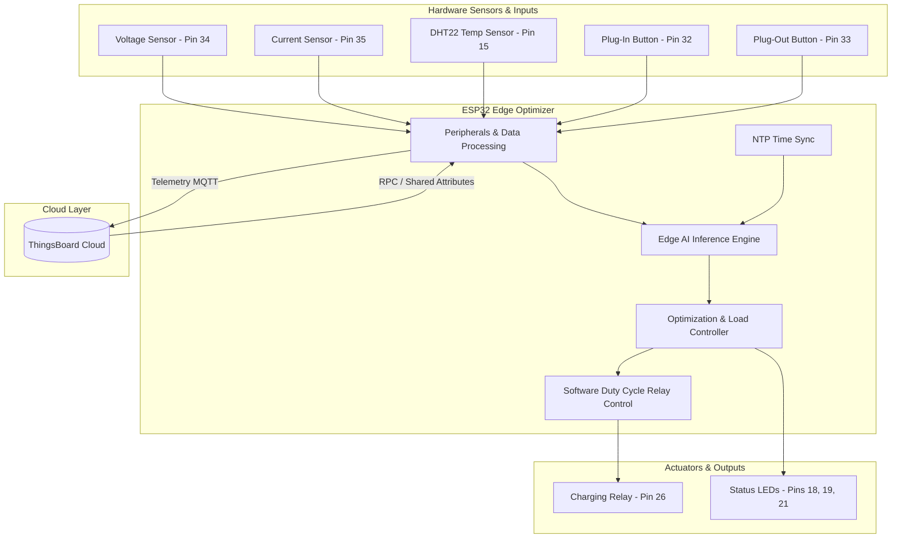

# Smart EV Charging Station Optimizer using Edge AI

[](https://platformio.org/)
[](https://www.espressif.com/en/products/socs/esp32)
[](https://www.arduino.cc/)
[](https://thingsboard.io/)
[](LICENSE)

An intelligent, edge-computing solution designed for Smart Electric Vehicle (EV) Charging Stations. Operating on an **ESP32 microcontroller**, this system uses lightweight embedded Machine Learning (Edge AI) to predict vehicle arrival probability and session duration, dynamically optimizing charging load to prevent grid overloads and reduce peak tariff electricity costs.

---

## 📋 Table of Contents

- [Overview](#-overview)
- [Key Features](#-key-features)
- [System Architecture](#-system-architecture)
- [Hardware Setup & Pinout](#-hardware-setup--pinout)
- [Edge AI Machine Learning Models](#-edge-ai-machine-learning-models)
- [Smart Load Optimization Logic](#-smart-load-optimization-logic)
- [ThingsBoard Cloud & Telemetry](#-thingsboard-cloud--telemetry)
- [Project Directory Structure](#-project-directory-structure)
- [Getting Started](#-getting-started)
- [Configuration](#-configuration)
- [License](#-license)

---

## 🔍 Overview

With the rapid expansion of Electric Vehicles, unmanaged charging at peak hours creates extreme grid stress and high energy tariffs for station operators. 

This project transforms a standard EV charging bay into an **AI-driven Smart Bay**. By executing Machine Learning models directly on the ESP32 (Edge AI), the system evaluates real-time telemetry, session history, and time metrics to make autonomous load-shedding and throttling decisions without cloud-dependent latency.

---

## ⚡ Key Features

- **On-Device Edge AI Inference**: Runs lightweight C++ compiled Machine Learning models directly on the ESP32:
  - **Arrival Probability Prediction**: Logistic Regression model for forecasting peak vehicle arrivals.
  - **Session Duration Prediction**: Decision Tree Regressor model estimating vehicle plug-in duration.
- **Dynamic Duty-Cycle Load Shedding**: Controls high-power charging relays via PWM-like duty-cycle software modulation (e.g., throttling to 50% or 70% load during peak/overload states).
- **Grid Overload & Safety Protection**: Automatic load-shedding when current exceeds station safety thresholds (e.g., $>8.0\text{ A}$) or total power cap ($>2000\text{ W}$).
- **NTP Time & Tariff Awareness**: Synchronizes with NTP servers to identify peak electricity tariff hours (18:00 - 21:00) and adjust power delivery accordingly.
- **IoT Cloud Connectivity (ThingsBoard)**: Real-time telemetry reporting over MQTT for voltage, current, active power, temperature, bay status, and AI metrics.
- **Remote RPC & Shared Attributes**: Supports server-side Remote Procedure Calls (RPC) for manual operator overrides and real-time remote configuration updates.
- **Visual Status Indicators**: RGB LEDs indicate operational states (`GREEN`: Free/Standby, `YELLOW`: Active Charging, `RED`: Overcurrent/Overload Alert).

---

## 🏗️ System Architecture



---

## 🔌 Hardware Setup & Pinout

| Hardware Component | ESP32 GPIO Pin | Function |
| :--- | :--- | :--- |
| **Voltage Sensor** | GPIO 34 | Analog input for mains voltage monitoring (0–230V mapped) |
| **Current Sensor** | GPIO 35 | Analog input for charging current measurement (0–10A mapped) |
| **DHT22 Sensor** | GPIO 15 | Temperature monitoring to prevent thermal runaway |
| **Relay Module** | GPIO 26 | Digital output for duty-cycle controlled charging power |
| **Plug-In Button** | GPIO 32 | Simulates EV connection (`CHARGING` state) |
| **Plug-Out Button** | GPIO 33 | Simulates EV disconnection (`FREE` state) |
| **Green LED** | GPIO 18 | Bay Free / Standby Indicator |
| **Yellow LED** | GPIO 19 | Bay Active / Charging Indicator |
| **Red LED** | GPIO 21 | Overcurrent / Station Overload Alert Indicator |

---

## 🧠 Edge AI Machine Learning Models

The embedded AI engine evaluates 6 key inputs to make real-time operational decisions:

1. `hourOfDay` (0–23)
2. `dayOfWeek` (0–6)
3. `bayOccupied` (0 or 1)
4. `recentAvgCurrent` (10-sample moving average)
5. `sessionElapsedMin` (Elapsed time since plug-in)
6. `historicalArrivalRate` (Time-of-day statistical baseline)

### 1. Arrival Probability Model (`Logistic Regression`)
Generated via `m2cgen`, converts feature vectors into arrival probabilities ($0.0 - 1.0$) via a sigmoid transformation:
$$\text{Probability} = \frac{1}{1 + e^{-z}}$$

### 2. Session Duration Predictor (`Decision Tree Regressor`)
Generated via `micromlgen`, estimates remaining charging time (in minutes) to determine whether a vehicle can be safely throttled without inconveniencing the user.

---

## ⚙️ Smart Load Optimization Logic

```
                    ┌───────────────────────────────┐
                    │      Read Sensors & State     │
                    └───────────────┬───────────────┘
                                    │
                         Is Bay Status CHARGING?
                        /                       \
                      YES                        NO
                      /                            \
      Current > Overload limit (8A)?         Peak Hour & High Arrival Prob?
       ├── YES ──> THROTTLE @ 50%              ├── YES ──> STANDBY_EXPECTING
       └── NO                                  └── NO  ──> LOW_DEMAND
           │
      Total Station Power > 2000W?
       ├── YES & Session Duration > 10m ──> THROTTLE @ 70%
       └── NO  ──> FULL POWER ALLOW @ 100%
```

---

## ☁️ ThingsBoard Cloud & Telemetry

### 📤 Telemetry Topic: `v1/devices/me/telemetry`
Published every 5 seconds over MQTT:
```json
{
  "bayId": "ESP32_WOKWI",
  "voltage": 230.0,
  "current": 6.5,
  "power": 1495.0,
  "temperature": 28.4,
  "bayStatus": "CHARGING",
  "predictedArrivalProb": 0.685,
  "predictedDurationMin": 45
}
```

### 📥 Remote Procedure Calls (RPC)
Supports cloud operator intervention over `v1/devices/me/rpc/request/+`:
- `setRelayState`: Forces relay `ON` ($100\%$) or `OFF` ($0\%$).
- `setThrottle`: Sets custom power throttle percentage ($0 - 100\%$).

---

## 📂 Project Directory Structure

```
.
├── include/
│   ├── AppNetwork.h       # WiFi and MQTT client declarations
│   ├── EdgeAi.h           # Edge AI interface header
│   ├── MapFloat.h         # Float mapping helper
│   ├── Model.h            # Embedded C++ ML Models (Logistic Reg & Decision Tree)
│   ├── Peripherals.h      # Sensor readings & GPIO interfaces
│   ├── State.h            # Global system state variables
│   ├── attributes.h       # Shared attributes handler
│   ├── config.h           # Pinouts, Wi-Fi credentials & threshold settings
│   ├── optimization.h     # Power throttling & duty-cycle control logic
│   ├── rpc.h              # Server-side RPC handler
│   └── telemetry.h        # Telemetry payload formatting
├── src/
│   ├── AppNetwork.cpp     # WiFi connection & MQTT broker communication
│   ├── EdgeAi.cpp         # Edge AI inference feature assembly
│   ├── MapFloat.cpp       # Analog scale mapping utility
│   ├── Peripherals.cpp    # Analog sensor polling & button state Machine
│   ├── State.cpp          # Global state initialization
│   ├── attributes.cpp     # Synchronizing shared attributes from ThingsBoard
│   ├── main.cpp           # Arduino setup() and loop() entry point
│   ├── optimization.cpp   # Power management decisions & duty-cycle relay driving
│   ├── rpc.cpp            # Remote RPC command handling
│   └── telemetry.cpp      # MQTT telemetry publishing
├── platformio.ini         # PlatformIO project & dependency configuration
└── README.md              # Project documentation
```

---

## 🚀 Getting Started

### Prerequisites

- [VS Code](https://code.visualstudio.com/) with the [PlatformIO IDE Plugin](https://platformio.org/platformio-ide) installed.
- ESP32 Development Board (`esp32doit-devkit-v1`).
- Hardware components listed in [Hardware Setup & Pinout](#-hardware-setup--pinout).

### Installation & Build

1. **Clone the Repository**:
   ```bash
   git clone https://github.com/sushantkumarkhobian-lab/EdgeAI-smart-EV-charging-station-optimizer.git
   cd EdgeAI-smart-EV-charging-station-optimizer
   ```

2. **Open in PlatformIO**:
   Open VS Code, select **File > Open Folder**, and choose the project directory.

3. **Configure Network & Cloud Settings**:
   Open `include/config.h` and update your Wi-Fi and ThingsBoard credentials:
   ```cpp
   #define WIFI_SSID "YOUR_WIFI_SSID"
   #define WIFI_PASS "YOUR_WIFI_PASSWORD"
   #define TB_TOKEN  "YOUR_THINGSBOARD_ACCESS_TOKEN"
   ```

4. **Build and Upload**:
   - Connect your ESP32 board via USB.
   - Click the **PlatformIO Upload** button (or run `pio run -t upload`).
   - Open Serial Monitor at **115200 baud**.

---

## ⚙️ Configuration

Key operating parameters can be adjusted in `include/config.h` or updated dynamically via ThingsBoard Shared Attributes:

```cpp
#define peakTariffStartHr 18         // Peak tariff start (6 PM)
#define peakTariffEndHr   21         // Peak tariff end (9 PM)
#define predictionThreshold 0.50     // AI arrival probability trigger threshold
#define overloadCurrentA  8.0        // Max current per bay (Amperes)
#define maxStationLoadW   2000.0     // Max station power limit (Watts)
```

---

## 📄 License

This project is licensed under the [MIT License](LICENSE).
